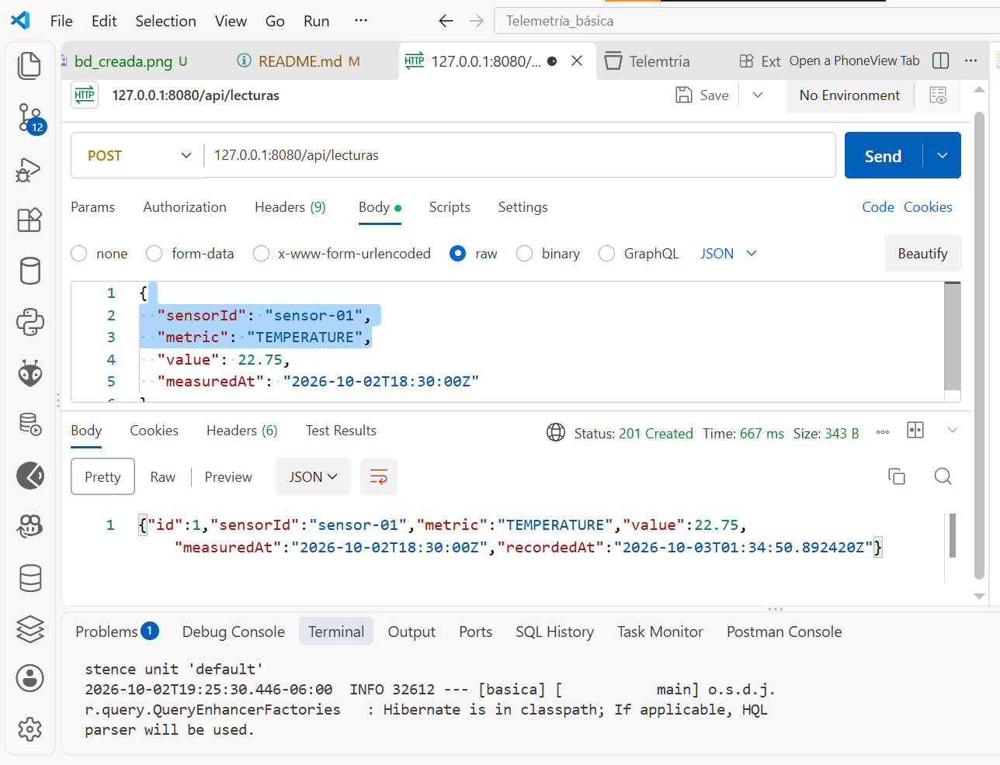
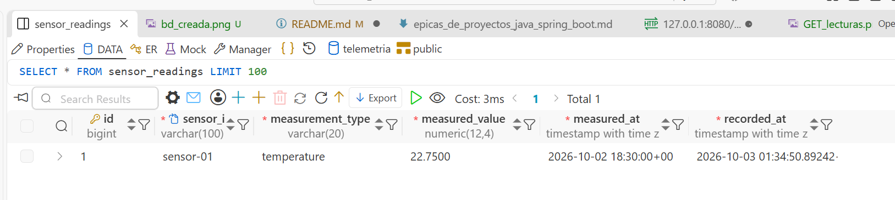
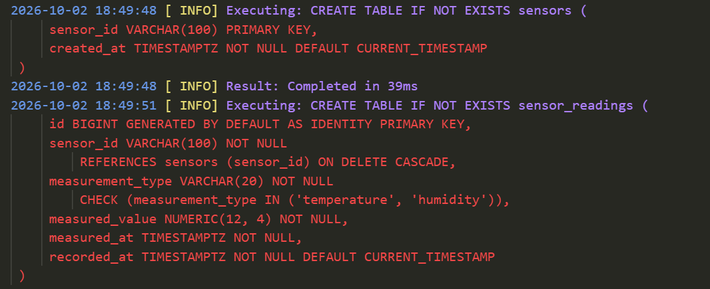

# Huertos comunitarios y telemetría ambiental

Proyecto académico Java/Spring Boot con dos microservicios y PostgreSQL:

- **Parcel Service**: CRUD de parcelas con ubicación, tipo de suelo y responsable.
- **Telemetry Service**: recibe y consulta lecturas ambientales de sensores.

Cada microservicio tiene su propia base de datos PostgreSQL. Docker Compose orquesta los dos servicios y sus bases; Hibernate valida el esquema y no altera tablas existentes.

## Decisiones de seguridad (HU-SEC-001 / SEC-01)

El alcance de autenticación incluye **Telemetry Service** y **Parcel Service**. Las siguientes reglas describen el diseño acordado para la implementación; todavía no significan que la autenticación o HTTPS estén habilitados.

- **Emisión y validación de tokens:** Telemetry Service será el emisor local de JWT. Ambos servicios validarán los tokens con la misma clave configurada fuera del repositorio. No se almacenarán claves privadas, secretos ni contraseñas en Git.
- **Autenticación entre servicios:** Parcel Service obtendrá un token de servicio de Telemetry usando credenciales configuradas externamente y lo enviará como Bearer Token al llamar a sus endpoints. No se dejarán endpoints de negocio públicos para mantener esta integración.
- **Rutas públicas:** `POST /api/auth/**` para autenticación/emisión de tokens y `GET /health` para health checks.
- **Rutas protegidas:** todos los demás endpoints de negocio, incluidos `POST /api/lecturas`, `GET /api/sensores/{sensorId}/lecturas`, `GET /api/v1/sensors/{sensorId}/readings/latest` y las rutas `GET`, `POST`, `PUT` y `DELETE /api/v1/parcels/**`.
- **Autorización inicial:** se requiere un JWT válido para las rutas protegidas. Las solicitudes sin credenciales o con token inválido responderán `401`; la autorización por roles responderá `403` cuando se definan permisos de negocio específicos.
- **Transporte:** ambos servicios forman parte del alcance TLS. El keystore y sus contraseñas se suministrarán fuera del repositorio; las reglas exactas de HTTPS, TLS y tratamiento de HTTP se documentarán con la configuración de transporte.

## Requisitos

- Docker Desktop con Docker Compose.
- Para ejecutar pruebas localmente sin Docker: JDK 21 y Maven.

## Ejecutar el sistema completo

Desde la raíz del repositorio, inicia los dos microservicios y sus bases:

```powershell
docker compose up --build
```

La primera construcción puede tardar mientras Maven descarga las dependencias e imágenes. Cuando ambos servicios estén disponibles:

- Parcel Service: `http://localhost:8081`
- Telemetry Service: `http://localhost:8082`
- PostgreSQL de parcelas: puerto `5433`
- PostgreSQL de telemetría: puerto `5434`

Los health checks se consultan en `/health`. Las contraseñas predeterminadas del Compose son solo para desarrollo local; se pueden sustituir con las variables `PARCEL_DB_PASSWORD` y `TELEMETRY_DB_PASSWORD` en el entorno o en un archivo `.env` local. No reutilices esos valores en producción.

Para detener contenedores sin borrar datos:

```powershell
docker compose down
```

Los esquemas de `databases/init` se ejecutan automáticamente solo cuando se crea por primera vez cada volumen de PostgreSQL. Si ya tenías un volumen de telemetría antes de agregar nuevas métricas, ejecuta la migración desde la raíz:

```powershell
psql -h localhost -p 5434 -U telemetria -d telemetria -f databases/init/03-measurement-types.sql
```

Si el volumen de parcelas ya existía, añade la asociación con sensores:

```powershell
psql -h localhost -p 5433 -U telemetria -d parcels -f databases/init/04-parcel-sensor.sql
```

No borres volúmenes para aplicar cambios si contienen datos que debas conservar.

## Parcel Service

### Endpoints

| Método | Ruta | Resultado |
|---|---|---|
| `POST` | `/api/v1/parcels` | Crea una parcela (`201 Created`) |
| `GET` | `/api/v1/parcels` | Lista parcelas |
| `GET` | `/api/v1/parcels/{id}` | Consulta una parcela y las últimas mediciones de su sensor |
| `PUT` | `/api/v1/parcels/{id}` | Reemplaza los datos de una parcela |
| `DELETE` | `/api/v1/parcels/{id}` | Elimina una parcela (`204 No Content`) |

Ejemplo de cuerpo para crear o actualizar:

```json
{
  "name": "Huerto comunitario norte",
  "location": {
    "latitude": 28.6353,
    "longitude": -106.0889
  },
  "soilType": "LIMOSO",
  "ownerOrLead": "Comunidad vecinal",
  "sensorId": "sensor-01"
}
```

Valores aceptados para `soilType`: `ARCILLOSO`, `LIMOSO` y `ARENOSO`. Las coordenadas deben respetar los límites GPS (latitud −90 a 90 y longitud −180 a 180) y admitir hasta seis decimales. Los campos de texto obligatorios se recortan en los extremos y se rechazan si contienen marcas HTML (`<`, `>`), caracteres de control o están vacíos.

Cada parcela tiene un `sensorId` único para consultar el estado actual. Al crear una parcela nueva, incluye ese campo; al editar parcelas antiguas sin sensor, asígnales uno con `PUT`. Si el ID no existe, la API devuelve `404`; un sensor ya asignado produce `409`; las solicitudes inválidas responden `400` con los campos que requieren corrección. El esquema está en [02-parcels.sql](./databases/init/02-parcels.sql); [04-parcel-sensor.sql](./databases/init/04-parcel-sensor.sql) agrega la columna a instalaciones anteriores.

El detalle `GET /api/v1/parcels/{id}` consulta el último dato de cada métrica de ese sensor en Telemetry Service. `telemetryStatus` será `AVAILABLE` si tiene mediciones, `NO_DATA` si no las tiene y `UNASSIGNED` en registros antiguos sin sensor. Si Telemetry Service no responde, Parcel Service devuelve `503` en vez de un estado incompleto. Estos valores describen disponibilidad de datos y no son diagnósticos agronómicos.

## Telemetry Service

### Endpoints

| Método | Ruta | Resultado |
|---|---|---|
| `POST` | `/api/lecturas` | Recibe y guarda una lectura (`201 Created`) |
| `GET` | `/api/sensores/{sensorId}/lecturas` | Consulta lecturas con filtros y paginación |
| `GET` | `/api/v1/sensors/{sensorId}/readings/latest` | Devuelve la lectura más reciente por métrica del sensor |

Ejemplo de lectura:

```json
{
  "sensorId": "sensor-01",
  "metric": "SOIL_MOISTURE",
  "value": 47.25,
  "measuredAt": "2026-10-02T18:30:00Z"
}
```

Tipos aceptados: `TEMPERATURE`, `HUMIDITY`, `SOIL_MOISTURE`, `PH`, `NITROGEN`, `PHOSPHORUS`, `POTASSIUM` y `AIR_QUALITY`. Humedad y humedad del suelo aceptan 0–100; pH, 0–14; temperatura, −100–100; nutrientes y calidad del aire requieren valores no negativos. El registro del sensor se crea automáticamente al recibir su primera lectura. El esquema está en [01-sensors.sql](./databases/init/01-sensors.sql); [03-measurement-types.sql](./databases/init/03-measurement-types.sql) amplía el constraint para bases existentes.

La consulta acepta `from`, `to`, `page` (desde 0) y `size` (1–100):

```text
GET http://localhost:8082/api/sensores/sensor-01/lecturas?from=2026-10-01T00:00:00Z&to=2026-10-03T00:00:00Z&page=0&size=20
```

## Probar con Postman

1. Ejecuta `docker compose up --build`.
2. En Postman, selecciona **Import** e importa:
   - [Colección de Parcel Service](./postman/parcel-service.postman_collection.json)
   - [Colección de Telemetry Service](./postman/telemetria.postman_collection.json)
3. En la colección de parcelas ejecuta **Crear parcela** primero. El test guarda el ID devuelto en `parcelId` para las solicitudes posteriores.
4. Ejecuta listar, consultar, actualizar y eliminar. Las operaciones de actualización y eliminación deben realizarse antes de borrar la parcela.
5. En la colección de telemetría registra una lectura y consulta el historial del sensor.

## Ejecutar pruebas

Las pruebas usan H2 en memoria y no requieren que PostgreSQL esté activo. Desde la raíz:

```powershell
mvn -f parcel-service/pom.xml test
mvn -f basica/pom.xml test
```

## Alcance del caso

La implementación cubre los dos microservicios base, el CRUD de Parcel, la recepción y consulta de telemetría, validación de entradas, sanitización básica de texto, errores personalizados y orquestación con Docker Compose. El detalle de la parcela consulta las últimas mediciones por tipo para el sensor asociado. Alertas en tiempo real, recomendaciones agronómicas y gestión de voluntarios se describen en el caso, pero no incluyen contratos ni reglas de negocio concretas en el enunciado; requieren una especificación adicional antes de implementarse.

### Evidencias del desarrollo de telemetría








